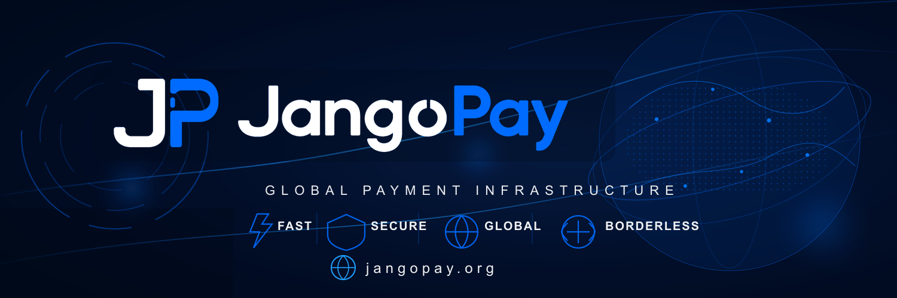
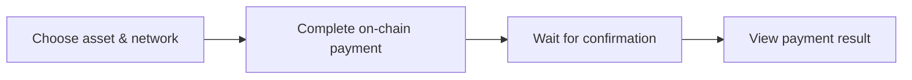

<a href="README.zh-CN.md">简体中文</a> · <a href="https://www.jangopay.org/">Website</a> · <a href="mailto:contact@jangopay.org">Contact</a>

<h1 align="center">Payments that connect your business to the world.</h1>

USDT/USDC payment tools for small and midsize online merchants and developers.

---

## Build your payment flow with JangoPay

Start accepting USDT and USDC with Payment Links, or connect your website and backend through the API and Webhooks. Track payments and manage assets in the merchant workspace. Available assets and networks depend on your account.

| Start collecting | Connect your systems | Run your operations |
| :--- | :--- | :--- |
| **Payment links** — create a payment page and share it with customers, without building a checkout from scratch. | **API & Webhooks** — connect payment creation and status notifications to websites, applications and business backends. | **Merchant workspace** — follow collection status, balances, transfers and customer activity. |

## Find the right path for your business

| Scenario | Start here | Integration scope |
| :--- | :--- | :--- |
| AI / SaaS credit top-ups | [Business scenarios](https://github.com/jangopay/jangopay-docs/blob/main/docs/en/business-scenarios.md) · [API guide](https://github.com/jangopay/jangopay-docs) | Create payments and use verified status to credit users in your own system; no ready-made AI-panel plugin is listed here. |
| Digital goods | [Digital delivery workflow](https://github.com/jangopay/jangopay-examples/blob/main/recipes/workflows.en.md#digital-delivery) | Confirm payment before releasing downloads, licenses or access. |
| WooCommerce | [Plugin overview](https://github.com/jangopay/jangopay-integrations/tree/main/woocommerce) · [WordPress.org](https://wordpress.org/plugins/jangopay-for-woocommerce/) | Published plugin 1.0.2 for one-time USD orders using JangoPay hosted checkout. |
| VPN / Hosting | [Service renewal workflow](https://github.com/jangopay/jangopay-examples/blob/main/recipes/workflows.en.md#service-renewal) | Connect each confirmed payment to provisioning or renewal in your own system; no ready-made VPN/hosting plugin is listed here. |

The scenario guides describe merchant workflows, not automatic recurring billing or a promise of a platform-specific integration.

## Developer resources

| Repository | What you will find |
| :--- | :--- |
| [**jangopay-docs**](https://github.com/jangopay/jangopay-docs) | Bilingual API onboarding, invoice and Webhook guides, product scope and integration planning. |
| [**jangopay-examples**](https://github.com/jangopay/jangopay-examples) | Node.js, Python and PHP server request examples, plus merchant workflow recipes; not an SDK. |
| [**jangopay-integrations**](https://github.com/jangopay/jangopay-integrations) | Published [WooCommerce 1.0.2](https://github.com/jangopay/jangopay-integrations/tree/main/woocommerce) and [Azuriom Shop 1.0.4](https://github.com/jangopay/jangopay-integrations/tree/main/azuriom) plugins, setup guides and source. |

For the current API contract, use the [official API Reference](https://doc.jangopay.org/api-reference).

## A clear customer experience

## Stay connected

[Website](https://www.jangopay.org/) · [X](https://x.com/JangoPayGlobal) · [Telegram](https://t.me/jangopay)

**Product questions, integrations and partnerships:** [contact@jangopay.org](mailto:contact@jangopay.org)

These repositories document JangoPay’s public product experience. They do not open-source the payment backend or constitute an official SDK/API contract.
