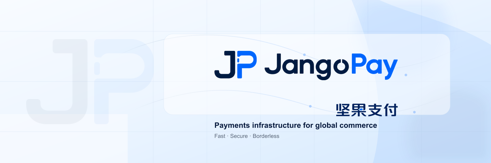
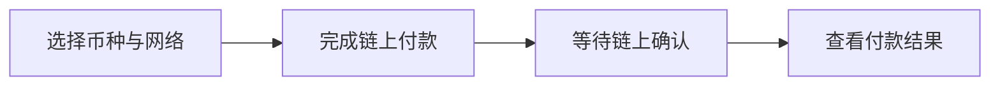

<a href="README.md">English</a> · <a href="https://www.jangopay.org/">Website</a> · <a href="mailto:contact@jangopay.org">Contact</a>

<h1 align="center">让你的业务，连接全球付款。</h1>

面向中小在线商户与开发者的 USDT/USDC 稳定币收款工具。

---

## 用 JangoPay 构建更清晰的支付流程

通过收款链接开始接收 USDT、USDC，或用 API 与 Webhook 将付款状态接入网站和业务后台；在商户工作台跟踪收款并管理资产。具体可用币种和网络以账户配置为准。

| 快速开始收款 | 连接业务系统 | 管理支付运营 |
| :--- | :--- | :--- |
| **收款链接** — 创建付款页面并分享给客户，无需从零开发结账页。 | **API 与 Webhook** — 将订单创建、收款状态与通知连接到网站、应用或业务后台。 | **商户工作台** — 查看收款状态、币种余额、资产转出与客户活动。 |

## 按业务场景找到接入入口

| 场景 | 从这里开始 | 接入边界 |
| :--- | :--- | :--- |
| AI / SaaS 额度充值 | [业务场景说明](https://github.com/jangopay/jangopay-docs/blob/main/docs/zh-CN/business-scenarios.md) · [API 指南](https://github.com/jangopay/jangopay-docs/blob/main/README.zh-CN.md) | 创建收款并在核实付款后由商户系统增加额度；这里没有现成的 AI 面板插件。 |
| 数字商品 | [数字交付流程](https://github.com/jangopay/jangopay-examples/blob/main/recipes/workflows.zh-CN.md#数字交付) | 确认付款后再交付下载内容、授权或账户权益。 |
| WooCommerce | [插件介绍](https://github.com/jangopay/jangopay-integrations/blob/main/woocommerce/README.zh-CN.md) · [WordPress.org](https://wordpress.org/plugins/jangopay-for-woocommerce/) | 已发布 1.0.2 插件，支持一次性 USD 订单与 JangoPay 托管收银台。 |
| VPN / Hosting | [服务续费流程](https://github.com/jangopay/jangopay-examples/blob/main/recipes/workflows.zh-CN.md#服务续费) | 商户系统在确认付款后自行开通或续期；这里没有现成的 VPN/Hosting 插件。 |

场景资料是商户业务流程参考，不代表自动周期扣款或特定平台已完成集成。

## 开发者资源

| 仓库 | 内容 |
| :--- | :--- |
| [**jangopay-docs**](https://github.com/jangopay/jangopay-docs) | 中英文 API 入门、收款单与 Webhook 指南、产品边界及接入规划。 |
| [**jangopay-examples**](https://github.com/jangopay/jangopay-examples) | Node.js、Python、PHP 服务端请求示例与业务流程模板；不是 SDK。 |
| [**jangopay-integrations**](https://github.com/jangopay/jangopay-integrations) | 已发布的 [WooCommerce 1.0.2](https://github.com/jangopay/jangopay-integrations/blob/main/woocommerce/README.zh-CN.md) 和 [Azuriom Shop 1.0.4](https://github.com/jangopay/jangopay-integrations/blob/main/azuriom/README.zh-CN.md) 插件、安装说明与源码。 |

最新接口契约请查阅[官方 API Reference](https://doc.jangopay.org/api-reference)。

## 客户付款，步骤清晰

## 联系 JangoPay

[官网](https://www.jangopay.org/) · [X](https://x.com/JangoPayGlobal) · [Telegram](https://t.me/jangopay)

**产品咨询、技术接入与商务合作：** [contact@jangopay.org](mailto:contact@jangopay.org)

这些仓库介绍 JangoPay 的公开产品体验，不代表支付后台已开源，也不构成正式 SDK 或 API 接口契约。
